# CodeBrave Platform: User Guide and Capabilities Reference

**Prototype edition · November 2026**

This guide accompanies the CodeBrave interactive prototype. It explains what CodeBrave is, how to find your way around the prototype, what each workspace does, how AI is meant to help every employee, and, just as importantly, what works today and what is still to be built.

> **Please read this first.** Everything you see in the prototype uses **fictional people, schools and figures**. There is no real database, no real sign-in and no connected AI service. Where something is simulated, the prototype says so on screen, and this guide says so too. The demonstration "today" is fixed at **Tuesday 17 November 2026** so that dates and deadlines stay consistent.

---

## Contents

- [Part I: Introducing CodeBrave](#part-i-introducing-codebrave)
  - [What CodeBrave is](#what-codebrave-is)
  - [The problems it addresses](#the-problems-it-addresses)
  - [Programs, departments and partners](#programs-departments-and-partners)
  - [How the platform connects everything](#how-the-platform-connects-everything)
- [Part II: Getting started and navigation](#part-ii-getting-started-and-navigation)
  - [Opening the prototype](#opening-the-prototype)
  - [The screen layout](#the-screen-layout)
  - [Viewing as: switching personas](#viewing-as-switching-personas)
  - [Demo Center and guided scenarios](#demo-center-and-guided-scenarios)
  - [Resetting the demo](#resetting-the-demo)
  - [Simulated offline mode](#simulated-offline-mode)
  - [The different experiences](#the-different-experiences)
  - [Navigation tips and known limitations](#navigation-tips-and-known-limitations)
- [Part III: Workspace user manual](#part-iii-workspace-user-manual)
- [Part IV: AI at CodeBrave](#part-iv-ai-at-codebrave)
- [Part V: End-to-end workflows](#part-v-end-to-end-workflows)
- [Part VI: Interactive learning experiences](#part-vi-interactive-learning-experiences)
- [Part VII: Feature status and capabilities register](#part-vii-feature-status-and-capabilities-register)
- [Part VIII: Limitations and future development](#part-viii-limitations-and-future-development)
- [Part IX: Stakeholder demonstration guide](#part-ix-stakeholder-demonstration-guide)
- [Appendix A: Demonstration personas](#appendix-a-demonstration-personas)
- [Appendix B: Useful addresses in the prototype](#appendix-b-useful-addresses-in-the-prototype)
- [Appendix C: Glossary](#appendix-c-glossary)

---

## Part I: Introducing CodeBrave

### What CodeBrave is

CodeBrave is an education organization with two programs:

- **School Upskilling** brings digital skills into public schools. CodeBrave trains and deploys **Teaching Fellows**, supports **class teachers**, visits schools, observes lessons and measures pupil learning every year.
- **Future Builders** trains young people aged 15 to 18 in AI, web development and entrepreneurship, through real client projects, mentorship and internships.

The **CodeBrave Platform** is the organization's shared operating system: one connected place where staff, learners, teachers and partners do their work, where information is entered once and reused everywhere, and where AI helps every employee do more.

It is **not** just an administrative dashboard, and it is **not** just a chatbot. A register taken in a classroom updates attendance figures for the co-founder; a low classroom observation creates a coaching task for a Project Officer; a lesson published by the Curriculum Manager appears for students; feedback from classrooms flows back to improve that lesson. AI sits across all of it, helping people understand, write, analyze and act.

### The problems it addresses

| Today's difficulty | What the platform aims to do |
|---|---|
| Information is spread across spreadsheets, forms, chats and email. | One shared set of records, used by every workspace. |
| The same data is typed several times (registers, assessment results, reports). | Enter once, reuse everywhere: registers feed indicators, indicators feed donor reports. |
| Field staff often work with poor connectivity. | Forms and registers that can be completed offline and synchronized later. |
| Management sees results late, after manual consolidation. | Live indicators calculated from day-to-day records, with links to the evidence. |
| Curriculum improvements depend on informal feedback. | A visible loop from classroom feedback and observations back to curriculum revisions. |
| Children's and learners' data needs strict protection. | Role-based access, stricter rules for minors, and safeguarding records that are isolated. |
| Few employees use AI, or use it unsafely. | Secure, easy AI for everyone, which also suggests what it could do for each role. |

### Programs, departments and partners

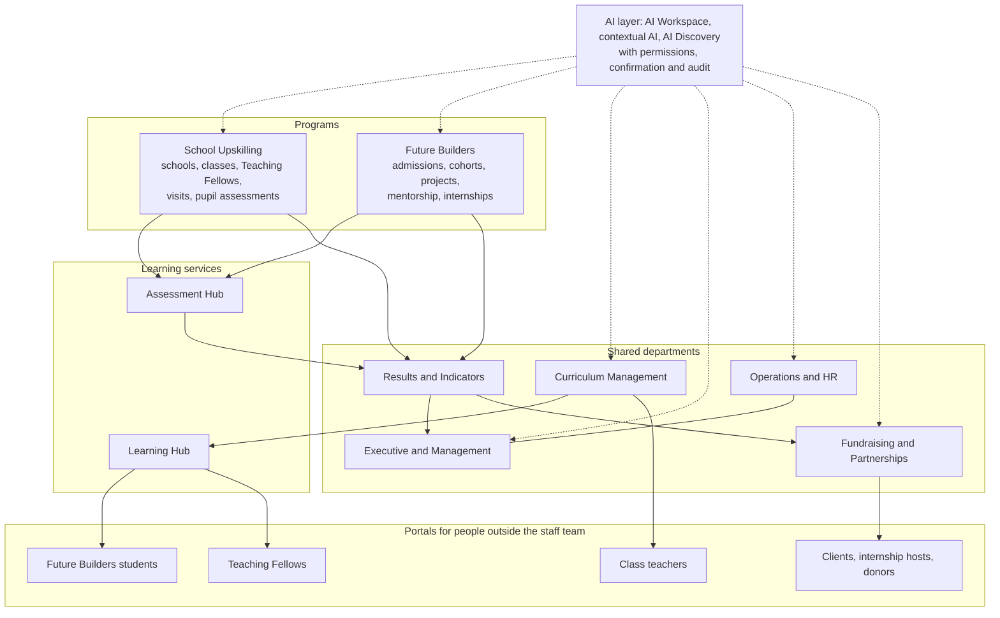

**Shared departments**

- **Curriculum Management** designs, reviews, approves and publishes what is taught in both programs.
- **Executive & Management** (the co-founders and program managers) steer the organization: decisions, risks, priorities and reporting.
- **Operations & HR** handles people, requests, leave, assets, recruitment and onboarding.
- **Fundraising & Partnerships** manages donors, opportunities, proposals, grants and donor reports.
- **Results & Indicators** (monitoring and evaluation) keeps the official figures and their evidence.

**External stakeholders** use dedicated, restricted portals:

- **Future Builders students**: their learning, assignments, team project, portfolio and internships.
- **Teaching Fellows**: their training, assessments, certificate and, once deployed, their classes.
- **Class teachers** in partner schools: their own classes, registers and assigned lessons (English and Arabic).
- **Partners**: clients (their project), internship hosts (openings and consented candidates) and donors (approved reports and indicators for their grant).

Pupils in partner schools **do not have accounts**. Their attendance and assessment records are kept by their teachers.

### How the platform connects everything

The idea at the heart of CodeBrave is that **one action in one place is immediately useful everywhere else**. Examples that work in the prototype:

| Action | Where it happens | Where it shows up |
|---|---|---|
| A class teacher submits a register | Class Teacher experience | Class attendance, school profile, the pupil attendance indicator, the co-founder's cockpit |
| A Project Officer records a low observation score | Field mode or Visits | A coaching follow-up is created and the Project Manager is notified |
| A Teaching Fellow passes the post-training assessment | Teaching Fellow portal | Certification eligibility, the Project Manager's approval queue, then a certificate and deployment |
| The Curriculum Manager publishes a version | Curriculum Management | A course in the Student Portal or Teaching Fellow portal, or the teachers' lesson list |
| A request is submitted | My requests | Approver's Inbox, Operations queue, requester notifications |
| The co-founder approves a decision | Executive cockpit | The linked request, donor report or funding opportunity is updated and a follow-up task is created |

---

## Part II: Getting started and navigation

### Opening the prototype

The prototype runs on a computer as a local web application.

| Item | Value |
|---|---|
| Address | `http://localhost:5180` |
| Project branch | `prototype/foundation` |
| Recommended browser | A current desktop browser (Chrome, Edge or Firefox). Field mode is designed for phone width. |

If the prototype is not already running, someone with the project folder can start it by opening a terminal **in the project folder** and running `npm install` (first time only), then `npx vite --port 5180`. On Windows, start it from PowerShell or Command Prompt so that the folder path begins with an upper-case drive letter (`C:\…`). Starting it from some other shells can produce an "Unexpected Application Error" when the page first loads.

### The screen layout

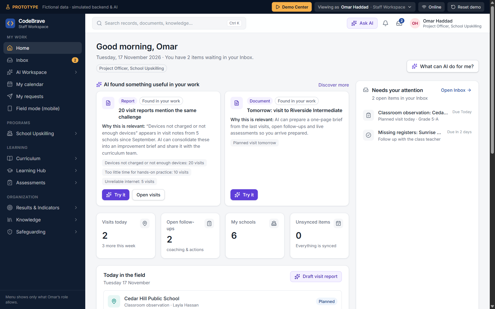
*Figure 1. The Staff Workspace as Omar Haddad, a Project Officer. The dark strip at the very top is the **prototype bar** (demonstration controls). Below it: the left-hand menu, the search bar, the "Ask AI" button, notifications, the Inbox and the user. Home opens with suggestions AI found in Omar's own work, followed by his role-specific panels.*

The screen has four zones:

1. **Prototype bar** (dark strip at the top). It exists only for demonstrations: **Demo Center**, **Viewing as** (persona switcher), the **Online/Offline** toggle and **Reset demo**. None of these would exist in a real deployment.
2. **Left-hand menu**. It shows only what the current person's role allows. Sections: **My Work** (Home, Inbox, AI Workspace, My calendar, My requests, and Field mode for field staff), **Programs** (School Upskilling, Future Builders), **Learning** (Curriculum, Learning Hub, Assessments), **Organization** (Executive, Results & Indicators, Fundraising & Partnerships, Operations & HR, Knowledge, Safeguarding) and **Admin**. A note at the bottom reminds you that the menu reflects the role.
3. **Top bar**. Search (`Ctrl K`), **Ask AI** (opens the AI assistant beside the page), notifications (bell), Inbox, and the person's name and title.
4. **Page area**. Each workspace page has a title, a short description, a row of section links and, where relevant, an **AI actions** menu.

### Viewing as: switching personas

The prototype contains 20 fictional people (see [Appendix A](#appendix-a-demonstration-personas)). Click **Viewing as** in the prototype bar and choose a person. The whole application changes to what that person would see: the menu, the Home page, the data they may access and the actions they may take. People who use a portal (students, Teaching Fellows, teachers, partners) are taken to their portal.

> **Persona switching is a demonstration device, not a login.** In a real deployment each person signs in with their own account and never sees the switcher. The prototype has no passwords and no real security: it *shows* what each role would see, but anyone using the prototype can switch to anyone.

The class teacher and Teaching Fellow experiences also have an **EN · ع** switch for Arabic, right-to-left display.

### Demo Center and guided scenarios

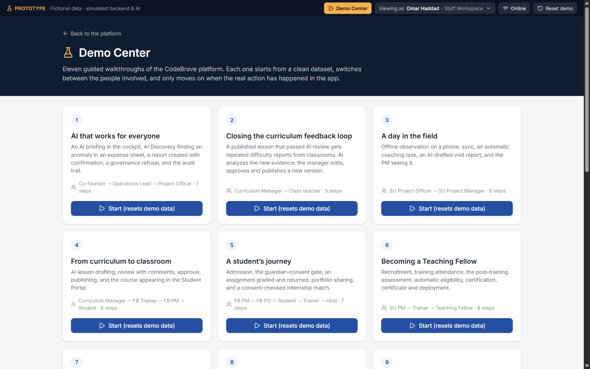
*Figure 2. The Demo Center. Each card is a guided walkthrough showing the roles involved and the number of steps.*

Open it with the orange **Demo Center** button. There are **13 guided scenarios** (the page introduction still says "Eleven", which predates the two newest scenarios):

| # | Scenario | Who is involved |
|---|---|---|
| 1 | AI that works for everyone | Co-founder → Operations Lead → Project Officer |
| 2 | Closing the curriculum feedback loop | Curriculum Manager → Class teacher |
| 3 | A day in the field | SU Project Officer → SU Project Manager |
| 4 | From curriculum to classroom | Curriculum Manager → FB Trainer → FB PM → Student |
| 5 | A student's journey | FB PM → FB PO → Student → Trainer → Host |
| 6 | Becoming a Teaching Fellow | SU PM → Trainer → Teaching Fellow |
| 7 | Winning and reporting a grant | Fundraising → Co-founder → Donor |
| 8 | Running the organization | Co-founder |
| 9 | Getting things done | Project Officer → PM → Operations |
| 10 | Who sees what | Trainer, Fundraising, Host, Agent, Operations |
| 11 | Taking the register | Class teacher → Project Officer → Fundraising → Operations |
| 12 | Training attendance and certification | SU Trainer → SU PM |
| 13 | Spotting a student drifting | FB Trainer → FB Project Officer |

(SU = School Upskilling, FB = Future Builders, PM = Project Manager, PO = Project Officer.)

**How to run a scenario**

1. Click **Start (resets demo data)** on a card. The fictional data returns to its starting point.
2. A guide panel appears in the bottom corner with the current step, the person to act as and what to do.
3. Click **Take me there** to switch to the right person and page automatically.
4. Do the action described. Most steps tick themselves off when the action has really happened in the data. Steps that are only about looking at something have an **I've seen this** button.
5. Click **Next step** (or **Skip**) to continue. The panel explains the consequence of each step. **Exit scenario** leaves the guide.

### Resetting the demo

Click **Reset demo** in the prototype bar and confirm. All fictional records return to their starting state, the device goes back online and the language returns to English. Starting any Demo Center scenario also resets the data.

Changes you make are kept **only in the current browser tab**. Closing the tab, or opening the prototype in a new tab, starts again from the original data. Conversations in the AI Workspace are kept only until the page is reloaded.

### Simulated offline mode

Field work often happens without a signal. The **Online/Offline** button in the prototype bar simulates losing the connection. While "offline":

- registers, observation forms and assessment entries are saved "on the device" and shown as **pending sync**;
- a queue of unsynced items is visible (for field staff, in **Field mode › Sync**);
- switching back **Online** uploads the queue and the records change to **submitted**.

Nothing is actually stored on the device beyond the browser tab. This demonstrates the intended behavior.

### The different experiences

| Experience | Who uses it | Where |
|---|---|---|
| **Staff Workspace** | All CodeBrave employees; each sees only their areas | `/` |
| **Field mode** (phone layout of the Staff Workspace) | Project Officers and School Upskilling trainers in schools | `/field` |
| **Future Builders Student Portal** | Students aged 15 to 18 | `/student` |
| **Teaching Fellow Portal** | Teaching Fellows in training and deployed | `/tf` |
| **Class Teacher experience** | Teachers in partner schools (English and Arabic) | `/teacher` |
| **Partner Access** | Clients, internship hosts and donors | `/partner` |

### Navigation tips and known limitations

- **Choose the persona first.** Typing `/student` while viewing as a staff member does not show a meaningful student view; switch to the student persona instead.
- **Restricted pages show a clear "no access" message** rather than disappearing silently, so permissions can be demonstrated.
- **Breadcrumbs** at the top of each page lead back to the parent page.
- **Ask AI** opens a side panel; **Open in AI Workspace** inside it continues the same conversation full-screen.
- Search (`Ctrl K`) searches the fictional records and documents; it is a prototype search, not a full organizational index.
- In the development version, arriving at the AI Workspace from a Discovery card can occasionally list the same new conversation twice in the history. This is a display quirk of development mode and does not affect the answer.

---

## Part III: Workspace user manual

Each section covers purpose, users, pages, what you can do, step-by-step instructions where useful, connections and limitations. The status labels (**Available in prototype**, **Simulated**, **Proposed**, **Not yet available**) are defined in [Part VII](#part-vii-feature-status-and-capabilities-register).

### Executive and Co-founder

**Purpose.** A focused cockpit for leadership: program health, what needs a decision, what is off track, high risks, what is coming up, and AI-generated insight. Operational detail stays in the individual workspaces.

**Who.** Rana Khoury (Co-founder & Executive Director). Program managers have partial ("own assignments") access.

**Pages** (Executive menu): Overview (the cockpit), Programs & impact, Strategic priorities, Teams & workload, Projects & milestones, Risks & issues, Decisions, Meetings, Reports. The co-founder's **Home** page shows the same cockpit.

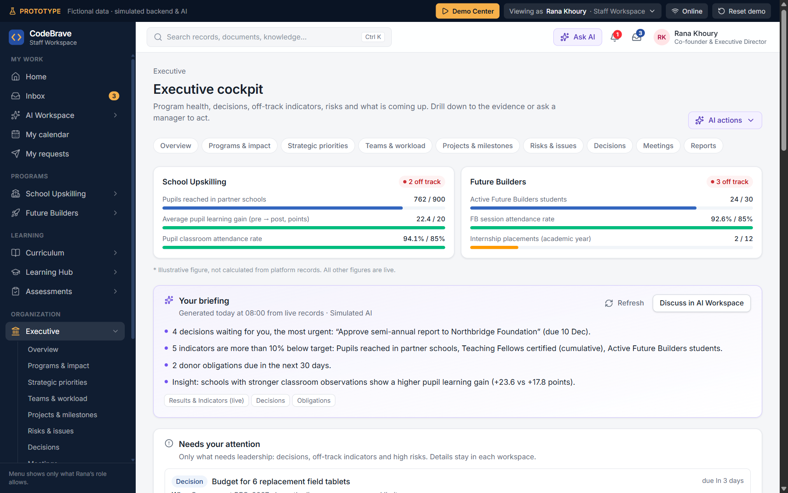
*Figure 3. The executive cockpit for Rana Khoury: the health of each program against its targets (live figures, with illustrative ones marked), and an AI briefing generated from the live records with links to its sources.*

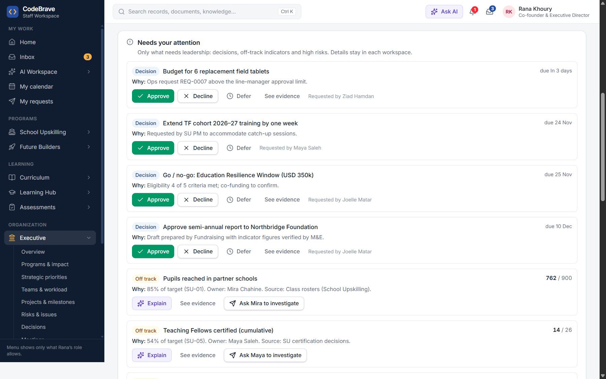
*Figure 4. "Needs your attention": each decision, off-track indicator or high risk states **why** it needs attention. Decisions can be approved, declined or deferred here; indicators can be explained by AI or passed to their owner to investigate.*

**What you can do**

- Read **Your briefing**: decisions waiting, indicators more than 10% below target, donor obligations due within 30 days, and one notable pattern. **Refresh** recomputes it; **Discuss in AI Workspace** continues the conversation.
- **Approve, decline or defer** decisions. Approving acts on what the decision governs: for example the linked purchase request moves on, a donor report is approved for submission, or a funding opportunity moves to drafting. A follow-up task is created for the requester.
- Click **Explain** to ask AI why an indicator is off track.
- Click **Ask [owner] to investigate** to send the responsible manager a high-priority Inbox task, with the evidence linked, and a notification.
- Review **Insights from AI** (for example, the relationship between classroom observation quality and pupil learning gain, or the pathway with the lowest attendance).
- See **Coming up in the next 30 days** (obligations, key meetings, deadlines, client milestones, Demo Day) and **Organizational developments**.
- Use **AI actions** for an executive briefing, indicator explanations, risks and opportunities, or strategic actions.

**Step by step: asking a manager to investigate**

1. Viewing as Rana, open **Executive › Overview**.
2. Under "Needs your attention", find an off-track indicator such as *Teaching Fellows certified (cumulative)*.
3. Click **Ask Maya to investigate**. The button changes to "Sent to Maya".
4. Switch to Maya Saleh: the task appears in her Inbox with a link to the indicator evidence.

**Connections.** Figures come from Results & Indicators, which calculates them from School Upskilling, Future Builders and assessment records. Decisions link to Operations requests and Fundraising obligations and opportunities. Meeting agendas (Executive › Meetings) are built from pending decisions, high risks and off-track indicators.

**Limitations.** The briefing and insights come from scripted logic over the fictional data (**Simulated**). Some indicators are illustrative samples and are marked as such.

### School Upskilling

**Purpose.** Run the partner-school program around **the schools themselves**: classes, teachers, Teaching Fellows, attendance, curriculum, assessments, visits, coaching and communication.

**Who.** Maya Saleh (Project Manager: all schools), Omar Haddad and Lina Farah (Project Officers: assigned schools), Jad Mansour and Nour Aziz (trainers: their schools and the Teaching Fellow cohort).

**Pages:** Overview, Schools, Classes & rosters, Teaching Fellows, Trainers, Training & TF attendance, Visits & observations, Follow-ups & coaching, Field activities, Team & assignments, Reports.

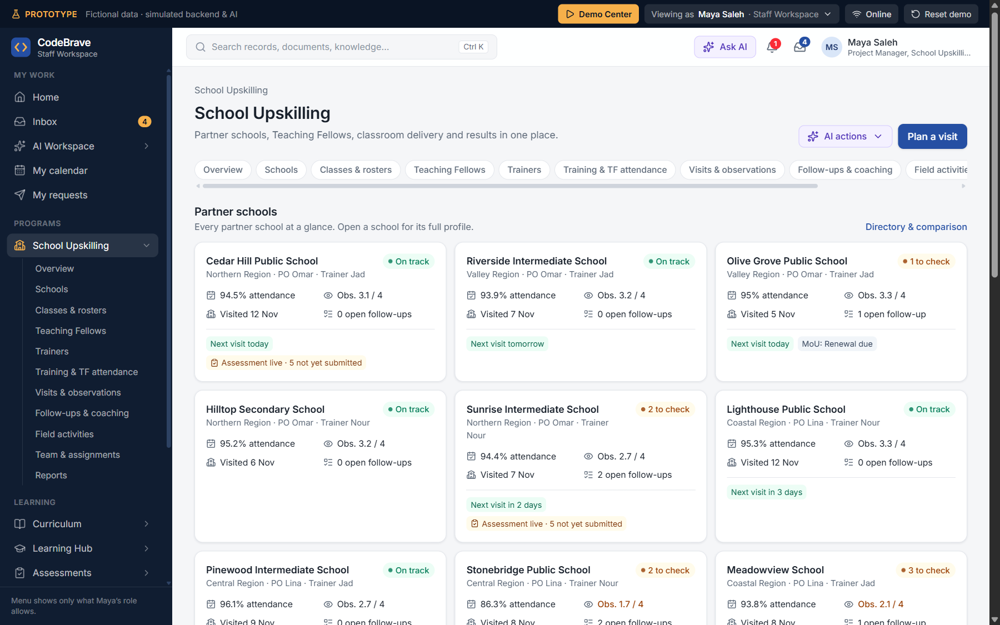
*Figure 5. The School Upskilling overview opens with the schools you work with ("Partner schools" for the manager, "My schools" for Project Officers and trainers). Each card shows attendance, the latest observation score, last visit, open follow-ups, next visit, live assessments, agreement status and a simple "On track / to check" flag.*

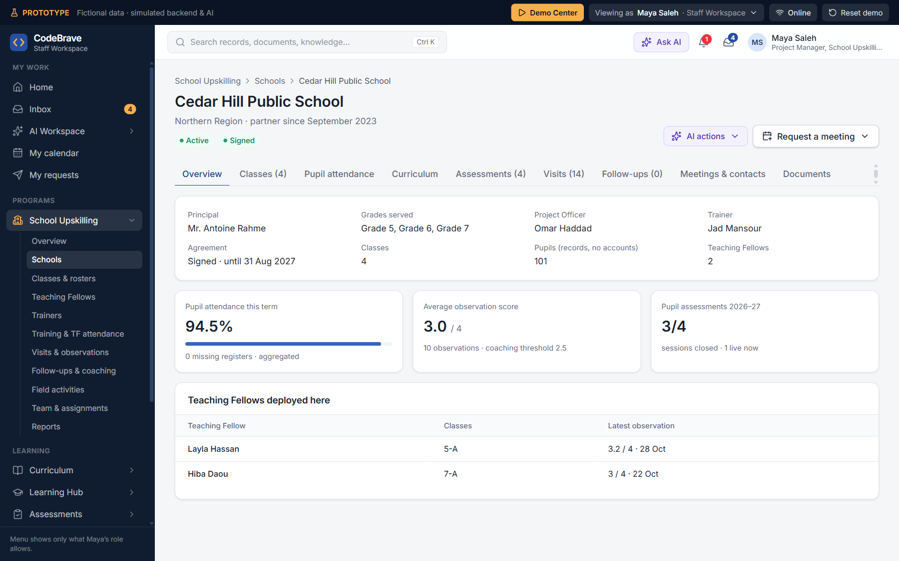
*Figure 6. The profile of Cedar Hill Public School, with tabs for overview, classes, pupil attendance (permission-controlled), curriculum, assessments, visits, follow-ups, meetings & contacts and documents, plus **AI actions** and **Request a meeting**.*

**What you can do**

- Open any school from the overview cards, or from **Schools** (directory and comparison table).
- On a school profile: review classes and their attendance; see which curriculum units are assigned to each grade; follow live assessments and their submission status; read visit notes and scores; review follow-ups; see meetings held and upcoming.
- **Request a meeting** with the principal or the assigned trainer. A pre-filled calendar event opens (date, agenda, participants, related school). Saving notifies CodeBrave participants and adds the meeting to the shared calendar and to the school's meeting history.
- Use **AI actions**: summarize this school, prepare a visit brief, analyze observations, draft a visit report, suggest follow-up actions, identify missing submissions.
- **Plan a visit**, complete an **observation** (scores of 1 to 4 on a rubric) and see a **coaching follow-up created automatically** when a score is below 2.5.
- Open a class to see its roster (pupil names only for people with the pupil-data permission), register history and corrections, and an **AI class learning profile** (see [Curriculum Management](#curriculum-management)).
- Manage the **Teaching Fellow** pipeline, training registers, certification and deployment (see [Part V](#part-v-end-to-end-workflows)).

**Permissions in practice.** Access to a school does **not** give access to pupil data. The manager sees attendance summaries; the assigned Project Officer holds the pupil-data permission (every view is logged); executives and fundraising staff see aggregated figures only.

**Limitations.** Registering a new school, editing school details, assigning Project Officers or trainers, and adding pupils or classes are **Not yet available** as forms; the prototype shows existing assignments and schools in onboarding. Contact details are placeholders.

### Field mode (mobile)

A phone-first view of the Staff Workspace for Project Officers and School Upskilling trainers, at `/field`, with five tabs: **Today**, **Schools**, **Attendance**, **Forms** and **Sync**. It offers large touch targets for observation rubrics, training registers, live assessment trackers, follow-ups and the offline sync queue. It is demonstrated in the scenario *A day in the field*. Offline storage is **Simulated**.

### Future Builders

**Purpose.** Run the youth program from admission to alumni: cohorts and sessions, attendance, pathways and competencies, team and client projects, portfolios, career readiness, mentorship and internships.

**Who.** Tarek Daher (Project Manager), Hala Rizk (Project Officer), Sami Khalil and other trainers.

**Pages:** Overview, Admissions, Cohorts & sessions, Students, Attendance, Pathways & competencies, Projects, Clients, Portfolios, Career readiness, Mentorship, Internships, Graduation & alumni, Reports.

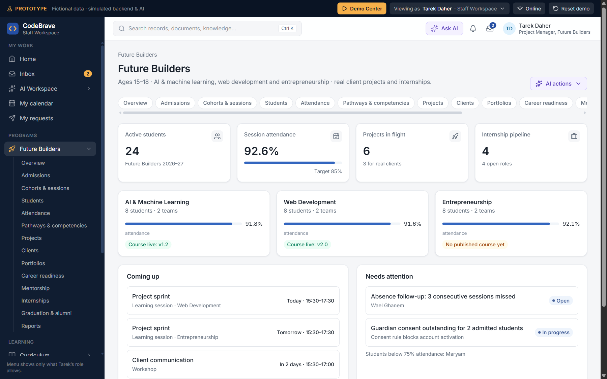
*Figure 7. Future Builders overview: active students, session attendance against target, projects, the internship pipeline, each pathway's attendance and live course version, upcoming sessions and items needing attention.*

**What you can do**

- Move applicants through **Admissions**. Admitted students under 18 stay inactive until **guardian consent** is recorded (the prototype has a **Simulate guardian consent** button).
- Take **session registers**. An absence-streak rule raises a follow-up when a student misses consecutive sessions, and the follow-up can be logged.
- Review **student profiles** (attendance, submissions, projects, placement).
- Review team and client **project milestones**; clients sign off milestones in Partner Access.
- Match students to **internships**; hosts see only consented candidates.
- Use **AI actions**: summarize cohort progress, identify learners needing support, analyze project progress, prepare mentorship summaries, draft the monthly report. Learner names are pseudonymised (for example "Student 07") in AI answers.

**Limitations.** Real guardian consent collection, messaging to families and client contracts are **Not yet available**.

### Curriculum Management

**Purpose.** Decide **what should be taught**: frameworks of objectives, curricula and their versions, lessons, resources and assessments, with review, approval, publishing and continuous improvement.

**Who.** Yasmin Awad (Curriculum Manager, full control). Program managers and trainers review; others can view.

**Pages:** Overview (including **Curriculum quality**), Frameworks, Curricula & builder, Lessons, Assessments & rubrics, Resources, Reviews, Publishing, Trainer feedback, Outcomes, Improvement backlog.

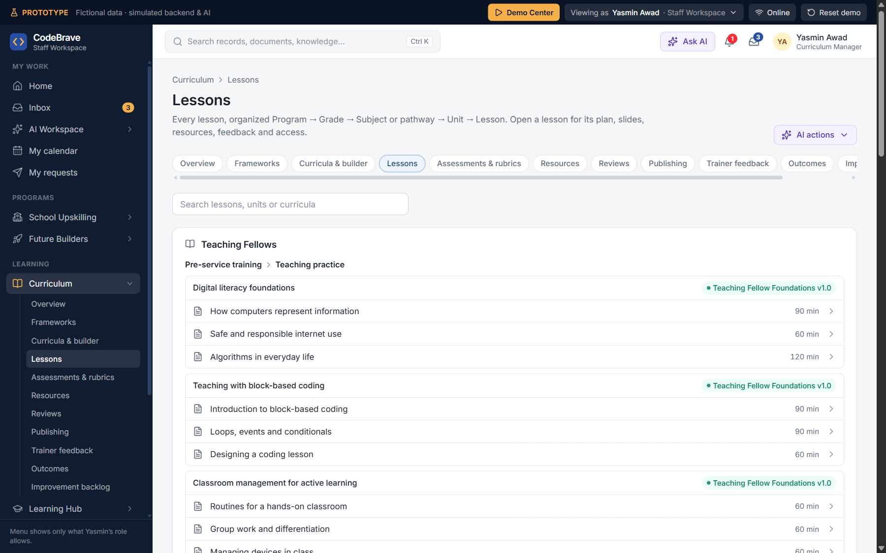
*Figure 8. Lessons are organized Program → Grade → Subject or pathway → Unit → Lesson. Each unit shows the curriculum and the version in use; lessons with repeated difficulty reports are flagged.*

**What you can do**

- **Curriculum quality** (on the Overview): lessons awaiting review, lessons reviewed by AI, published lessons, recommendations to approve, recent feedback, observation findings and lessons with recurring difficulties.
- **Open a lesson** to see its complete plan (objectives, timed activities, materials, differentiation, assessment), a **slide preview**, the **Interactive experience** tab, resources and linked assessments, **feedback & evidence**, **versions**, and **access** (grade-level access with lesson-level narrowing).
- **Versions**: create a new draft from the latest version, draft a lesson with AI, run **AI review before sending**, send for review, collect comments, approve (by the program manager) and **publish**. Publishing creates or updates the course in the Student Portal or Teaching Fellow portal; classroom curricula become teachers' lesson materials.
- **Improvement loop** (see [workflow 10](#10-feedback-and-curriculum-improvement)): when delivery evidence shows a problem with a published lesson, AI analyzes it and recommends changes; the manager edits, approves (creating a new version) and publishes.

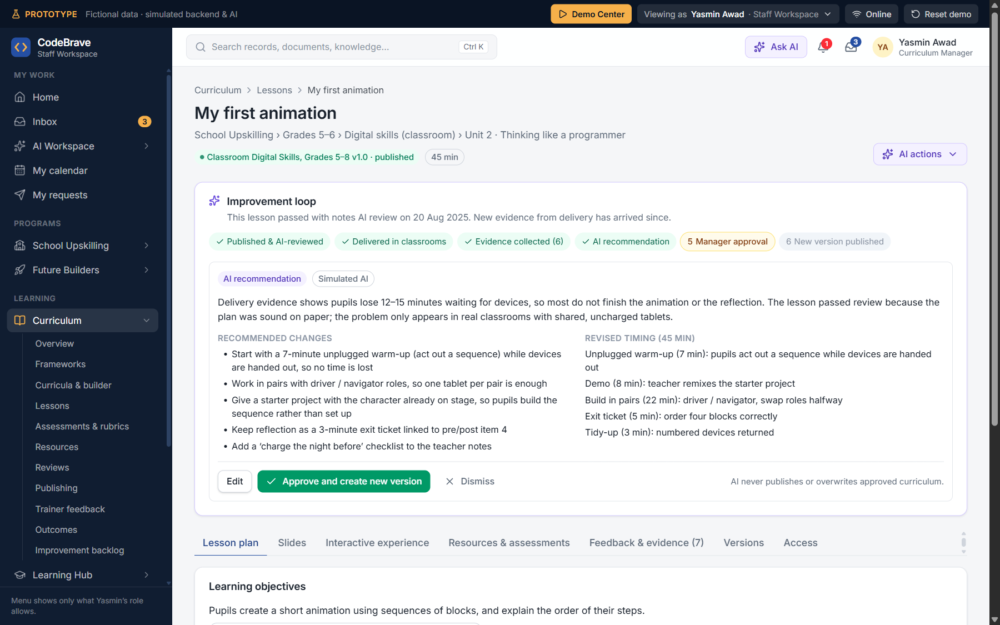
*Figure 9. "My first animation" passed AI review before publication, but six pieces of evidence from classrooms (teacher and trainer feedback, two observations and an assessment result) point to the same difficulty. AI explains the problem and recommends changes; nothing changes until the Curriculum Manager edits and approves.*

**Class learning profile.** On each class page (School Upskilling › Classes & rosters › a class), AI suggests a difficulty level, scaffolding and reinforcement for **the class as a whole**, from aggregated pre-assessment results, previous results and observations. It states explicitly that it never labels individual pupils.

**Limitations.** Most lesson plans are generated from a standard structure; only "My first animation" has a hand-written plan. Slides are a **Simulated** preview (no Google Slides). Lesson-level access changes show a confirmation but are **Simulated**. AI review and recommendations are scripted.

### Learning Hub

**Purpose.** Where learning **is accessed and delivered**. Curriculum Management decides what is taught; the Learning Hub turns each published version into a course in the right environment and tracks progress, grading and certificates.

**Pages:** Courses (with an explanation of how it all fits together), Cohort progress, Grading queue, Certificates, Announcements.

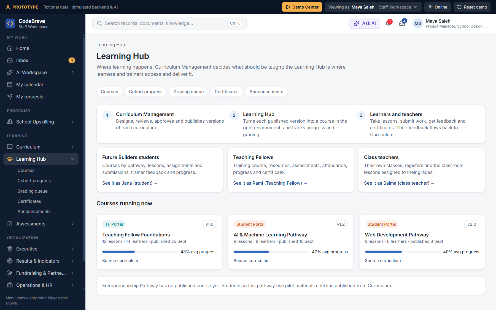
*Figure 10. The Learning Hub explains the chain Curriculum → Learning Hub → learners and teachers, offers "See it as…" links for a student, a Teaching Fellow and a class teacher, and lists the courses running now with their version and average progress.*

**What you can do.** See which courses are live and on which version; follow cohort progress; grade submissions in the grading queue; issue certificates; post announcements. "See it as Jana / Rami / Salma" switches persona and opens that person's learning view.

**Limitations.** Learning content is described rather than hosted: there is no video hosting, file storage or code-practice environment.

### Assessment Hub

**Purpose.** One place for assessment forms, assignments and **live submission tracking**, including the annual pupil pre/post assessments that feed School Upskilling's annual results.

**Pages:** Forms library, Form builder, Assignments, Live tracker, Responses, Analytics, Sync monitor.

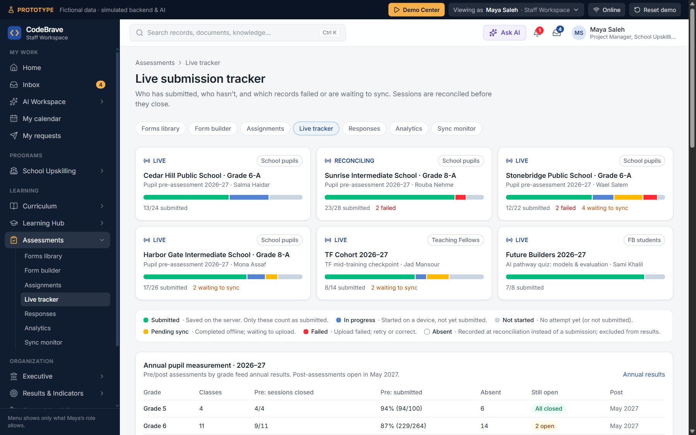
*Figure 11. The live submission tracker. Each live session shows saved submissions, in-progress, not started, pending synchronization and failed entries. The legend explains each status, including **Absent** (recorded during reconciliation). Below, the annual pupil measurement summary shows progress by grade.*

**What you can do**

- Filter sessions by status, audience, academic year, type (pre-assessment, post-assessment, course assessment), grade and school, and see the curriculum version each assessment relates to.
- Open a session to watch submissions arrive (**Simulate live activity**), **Retry upload** for failures, synchronize pending entries, move the session into reconciliation, record a resolution for each missing pupil (Absent, Exempt, Paper copy entered, Retake scheduled) and **Close session**. Only successfully saved submissions count as submitted.
- Closing a pupil pre-assessment session updates the annual results baseline.

**Limitations.** Pupil devices and submissions are simulated; there is no real test-taking application for pupils. The form builder demonstrates structure rather than being a full authoring tool.

### Results and Indicators

**Purpose.** The official figures: how CodeBrave is doing against its targets, how each figure is calculated, and the evidence behind it.

**Pages:** Dashboard, Indicator library, Targets, Annual results, Evidence library.

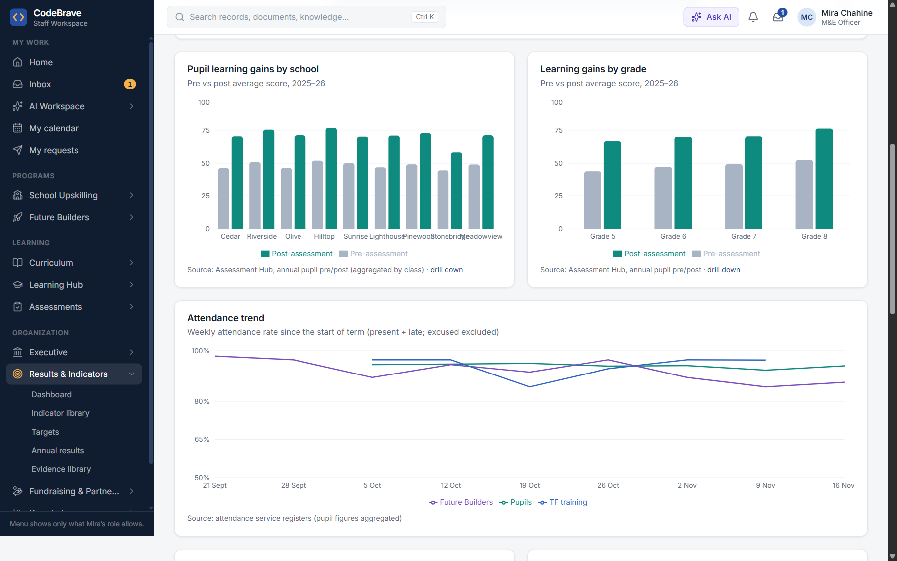
*Figure 12. Part of the Results dashboard: pupil learning gains by school and by grade (pre vs post), and weekly attendance trends for pupils, Future Builders and Teaching Fellow training. Program and grade filters apply to the charts.*

**What you can do**

- **Dashboard**: targets vs actuals (bars below 95% of target are highlighted), learning gains by school and grade, attendance trend, assessment completion by school, visit and observation coverage, Teaching Fellow certification, Future Builders learning progress, internship outcomes, and a historical trend for any indicator. Each chart names its source and links to a drill-down.
- **Indicator detail**: definition, calculation, period, target and owner, evidence link, trend and provenance.
- **Live vs illustrative**: ten indicators are calculated live from the records (pupils reached, learning gain, pupil attendance, register completion, Teaching Fellows certified, observation score, visit coverage, active Future Builders students, Future Builders attendance and internship placements). The rest are **illustrative** sample figures and are labelled as such.

**Limitations.** Earlier points in trend lines are recorded sample snapshots; only the latest point of a live indicator is calculated. Some charts elsewhere (for example lesson outcomes by objective) still use illustrative data.

### Operations and HR

**Purpose.** People and administration: directory, org chart, recruitment, onboarding, leave, requests, assets, tasks, workload and policies.

**Who.** Ziad Hamdan (Operations & HR Lead) and team. Other staff use **My requests**.

**Pages:** People directory, Org chart, Recruitment, Onboarding, Leave & attendance, Requests, Assets, Projects & tasks, Workload, Policies.

**What you can do.** Review and act on all requests (approve when it is your step, assign, mark complete; completing an equipment request allocates an available laptop); follow recruitment and onboarding checklists; see leave and the team calendar; track assets; use **AI actions** (analyze an operational spreadsheet, summarize requests, suggest process improvements, draft an email, prepare meeting notes).

**Limitations.** Payroll stays outside the platform. Leave balances and workload percentages are illustrative. Real HR record storage is **Not yet available**.

### Fundraising and Partnerships

**Purpose.** Donors and partners, the opportunity pipeline, proposals, grants, donor obligations, reports and evidence.

**Who.** Joelle Matar (lead) and team; the co-founder approves.

**Pages:** Overview, Donors & partners, Opportunities, Proposals, Grants, Obligations calendar, Reports, Evidence & stories.

**What you can do.** Move opportunities through stages; run an AI **eligibility check**; request a go/no-go decision from the co-founder; build a donor report with figures pulled live from Results & Indicators; send it for approval and, once approved, **submit it to the donor**, who then sees it in Partner Access. **AI actions** research opportunities, analyze eligibility, draft a proposal using live indicators and consented stories, and prepare donor reports.

**Limitations.** Funding opportunities are a fixed fictional list; "research" does not search the internet. Submission to a donor is **Simulated** (no email or donor system).

### Knowledge and Documents

**Purpose.** The organization's knowledge base (how-to articles and policies), templates and documents. The Safeguarding section sits alongside it.

**Pages:** Knowledge base, Templates, Documents. **Safeguarding:** Report a concern (everyone) and Cases (restricted to the Safeguarding Lead).

**What you can do.** Read articles; see templates and their fields; browse documents, including drafts saved from the AI Workspace (marked "private to you until you share it"); report a safeguarding concern.

**Limitations.** Documents are records only: files cannot be opened, edited or shared, and there is no Google Drive connection (**Not yet available**).

### Calendar and Meetings

**Purpose.** One shared calendar for the whole organization.

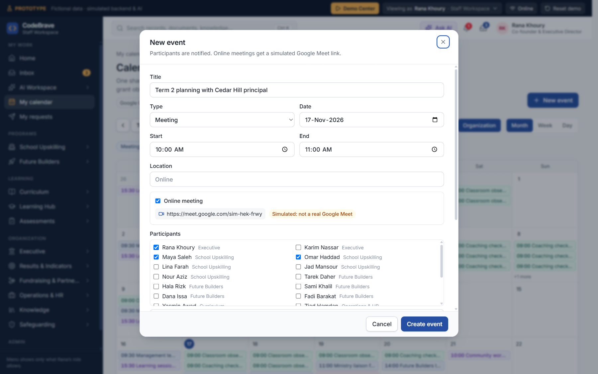
*Figure 13. Creating an event as Rana: type, date and time, location, an online meeting with a **simulated** Google Meet link (clearly labelled), participants (staff and external), the related school, cohort, project or department, agenda and description.*

**What you see.** Month, week and day views of the demo month (November 2026), filtered by **Mine**, **My team** or **Organization**, and by event type. Events include management and team meetings, interviews, curriculum reviews, community and client activities, deadlines and training, plus entries drawn automatically from other workspaces: school visits, Teaching Fellow training sessions, Future Builders sessions, grant obligations and staff leave.

**What you can do.** Click an event for its details and a link to its source; create, edit and delete events (participants are notified in the platform); request meetings directly from a school profile.

**Limitations.** Google Calendar synchronization and Google Meet are **Simulated**: no invitations are sent and the link does not open a real meeting. A few seeded school visits fall on weekends.

### Requests and Approvals

**Purpose.** A single way to ask for anything and see where it is.

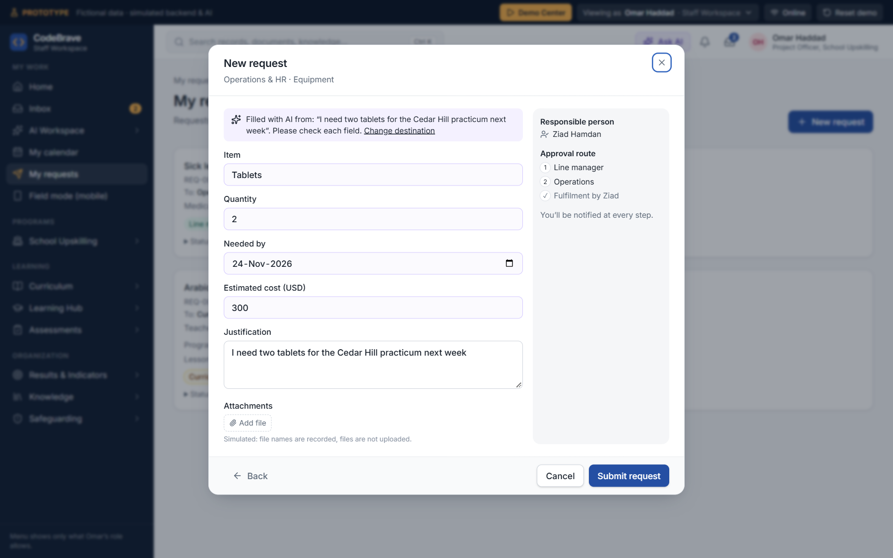
*Figure 14. A new request filled with AI from one sentence. The form adapted to the "Equipment" type (item, quantity, needed by, cost, justification); the right-hand panel shows the responsible person and the approval route. Nothing is submitted until the requester checks it and clicks Submit request.*

**Step by step**

1. Open **My requests › New request**.
2. Either describe what you need and click **Fill with AI**, or choose who the request is for: **Operations & HR**, **School Upskilling Manager**, **Future Builders Manager**, **Curriculum Manager** or **Executive**.
3. Choose the type (Equipment, Travel, Leave, Purchase, Curriculum, Program support or General); the form adapts to it.
4. Check the responsible person and approval route, add attachment names if needed, and click **Submit request**.
5. Approvers see the request in their **Inbox** and can approve or reject it there; Operations assigns and completes it; the requester is notified at each step. Each request card shows its destination, responsible person, answers, approval chain and **status history**.

**Limitations.** Attachments record the file name only; no emails are sent; approval routes are fixed by request type (Admin › Request types & approvals shows them) rather than editable.

### AI Workspace

The full-page AI assistant at `/ai`, with **Discover** and **AI & your data**, is described in [Part IV](#part-iv-ai-at-codebrave).

### Admin and Governance

**Purpose.** Configuration and oversight for the platform administrator (Elie Gerges).

**Pages:** Users & roles (permission matrix and demo users), Programs & cohorts, Attendance policies, Request types & approvals, Integrations, Agent Hub, Audit log, Data protection.

**What you can do.** See the role × data permission matrix that drives what everyone sees; review attendance policies; see request types and their approval routes; see planned integrations (all marked as simulated); see the AI agents, their guardrails and illustrative run counts, costs and a monthly AI budget (kept in Admin, not shown to regular staff); read the audit log, which includes AI answers, confirmed AI actions and refusals; review data-retention rules.

**Limitations.** Settings are illustrative: changing a policy or permission is not enforced by any back-end service. The audit log is a list in the browser, not a tamper-proof record.

### Student Portal

**Who.** Jana Saab, Web Development pathway (and other fictional students).

**Pages:** Home, My learning, Assignments, Team project, Portfolio, Career & internships, Announcements, Learning Assistant, Profile & privacy.

**What students can do.** Follow their course lesson by lesson; complete the published **interactive activity**; submit assignments and read feedback; see their team project milestones; curate a portfolio and control who can see it; apply for internships; use a Learning Assistant (scripted, **Simulated**). Students see only their own information.

### Teaching Fellow Portal

**Who.** Rami Youssef (in training) and Layla Hassan (deployed at Cedar Hill).

**Pages:** Home, My training, Training attendance, Assessments, Certificate, My deployment, My classes, Observations & coaching, Resources (English and Arabic).

**What Teaching Fellows can do.** Follow training and attendance; take the mid-training checkpoint and the post-training assessment; see eligibility and, once approved, the certificate; once deployed, take class registers and read observation feedback.

### Class Teacher experience

**Who.** Salma Haidar, Cedar Hill Public School.

**Pages:** Today, My classes, Assessments, Help, with an **EN · ع** switch for Arabic.

**What teachers can do.** See today's classes and which registers are due; take a register that **never marks everyone present automatically**, offline if needed; see attendance by class; follow live assessments; open **Lessons for my classes** (the published classroom curriculum for their grades, with an "Updated" badge when a lesson has been revised).

### Partner Access

- **Clients** (Nabil Saade, Mount Pine Bakery Co.): their project, milestones and feedback; they sign off milestones.
- **Internship hosts** (Rita Kassab, Brightline Digital): openings, consented candidates, interns and check-ins.
- **Donors** (Helen Moore, Northbridge Foundation): overview, approved reports, indicators and milestones for their grant only.

Partners see only what relates to their organization, and only approved or consented information.

---

## Part IV: AI at CodeBrave

CodeBrave's vision is that **every employee, including people who have never used AI, can use it securely and easily to improve their work and help the organization achieve its mission.** Nobody should have to learn prompting, models or technical terms. AI appears in three complementary ways, all built on one shared foundation.

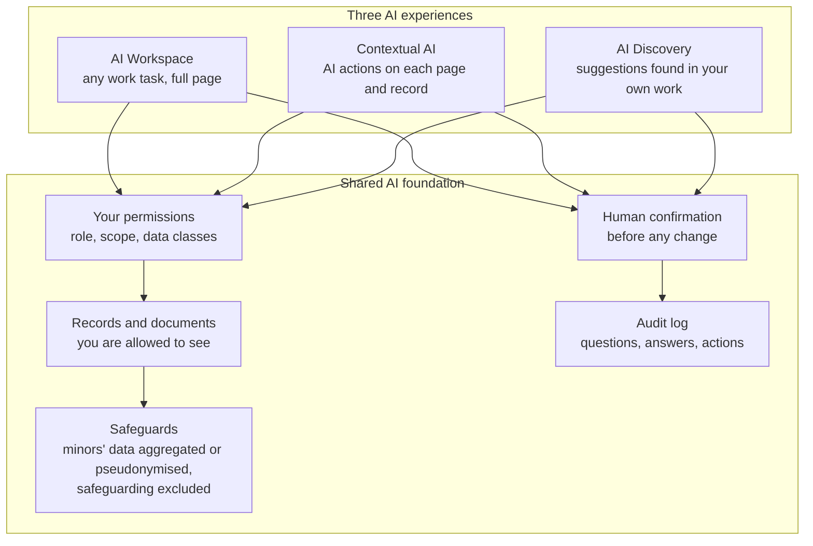

> **Simulated AI.** No AI model or provider is connected. Answers are produced by scripted logic that reads the fictional records, so the demonstration is consistent and never fails. Every AI answer is labelled **Simulated AI**. The experiences, safeguards and flows are those intended for production.

### A. AI Workspace

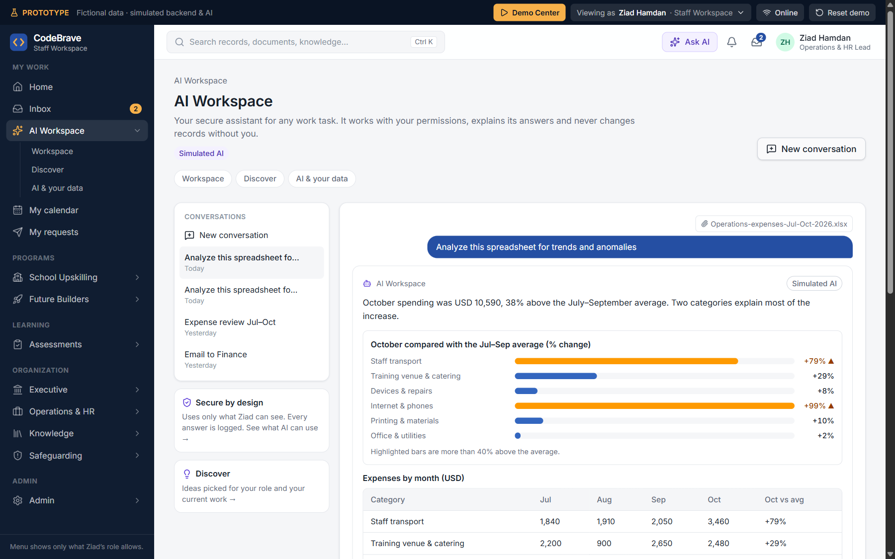
*Figure 15. The AI Workspace as Ziad (Operations & HR). On the left: conversation history, "Secure by design" and "Discover". On the right: an analysis of an attached expense spreadsheet, with a chart that highlights unusual categories and a table of the figures.*

**How to use it**

1. Open **AI Workspace** in the left menu (or go to `/ai`).
2. On a new conversation, pick one of the eight capability cards, or type your request in plain words and press Enter.
3. To attach a file, click the paper clip: choose one of six fictional sample files, or **Upload from this device**.
4. Watch the steps the assistant takes, then read the answer.
5. Use the actions under the answer: **Copy**, **Save to Documents**, **Send to my Inbox**, and the suggested follow-up questions.
6. Drafts (emails, letters, translations, briefs) have **Edit**, **Copy** and **Save** buttons, so you can change the text in place.
7. When the assistant proposes a change (for example "Create a management report from this"), it appears as a **suggested next step**. Nothing happens until you click it; **Not now** dismisses it.
8. Open **How I got this** to see the reasoning, steps and data used, and the reminder that the answer was written to the audit log.

**Capabilities demonstrated**

| Capability | Example to try | What you get |
|---|---|---|
| Spreadsheet and data analysis | Attach *Operations-expenses-Jul-Oct-2026.xlsx*: "Analyze this spreadsheet for trends and anomalies" | Chart, table, possible anomalies, offer to create a report |
| Survey analysis | Attach *Teacher-feedback-survey-Term-1.csv* | Themes, chart, suggested next steps |
| Email and letter drafting | "Draft an email to a school principal asking to meet about Term 1 progress" | Editable draft |
| Reports and presentations | "Create a board presentation outline for December" | Slide outline and speaker notes; "create the slides" is simulated |
| Summaries and meeting notes | Attach *Partner-meeting-notes-12-Nov.docx*: "Summarize these meeting notes" | Decisions, actions with owners; actions can be added to your Inbox |
| Translation and rewriting | Attach *Parent-letter-digital-skills.docx*: "Translate this letter into Arabic"; then "Make it shorter" | Arabic text, with a reminder to have it checked by a fluent colleague |
| Information extraction | Attach *Northbridge-call-for-proposals-2027.pdf*: "Extract the key dates, amounts and criteria" | Table with page references |
| Research and brainstorming | "Brainstorm ideas for engaging parents in the digital skills program" | Ideas, clearly marked as general knowledge |
| Planning and organization | "Help me plan my week" | A plan based on your Inbox and calendar; nothing is moved |
| Finding repetitive work to hand over | "Which of my tasks could AI do for me?" | Role-specific ideas with estimated time saved |
| CodeBrave records | "Which schools haven't been visited this month?", "Which students are at risk?", "Which TFs are ready for certification?" | Answers computed from the records you may see, often with a proposed action |

**Honest limitations.** Only the six sample files are "read". For a file uploaded from your computer, the assistant recognizes its type, says plainly that the prototype does not read the contents, and explains what it would do in production. Requests the scripts do not recognize receive a general structured draft and a note that the AI is simulated. Conversations disappear when the page is reloaded.

### B. Contextual AI

AI also appears **inside everyday work**: through the **AI actions** menu at the top of relevant pages, and the **Ask AI** button in the top bar. The assistant opens beside the page, knows what you are looking at, and can continue in the full AI Workspace.

| Role | Where | Examples of AI actions |
|---|---|---|
| Project Officer | School profile, Home | Summarize this school, prepare a visit brief, draft a visit report, suggest follow-up actions, consolidate recurring visit challenges into an improvement brief |
| Trainer and School Upskilling manager | School Upskilling overview | Analyze observations across schools, identify missing assessment submissions, find schools that need a visit |
| Curriculum Manager | Lessons and lesson pages | Review this lesson, analyze teacher and trainer feedback, recommend differentiated activities, translate the plan |
| Future Builders manager | Future Builders overview, Mentorship | Summarize cohort progress, identify learners needing support, analyze project progress, prepare mentorship summaries |
| Operations Officer | People directory, Projects & tasks | Analyze an operational spreadsheet, summarize requests, suggest process improvements, draft an email, prepare meeting notes |
| Fundraising Officer | Fundraising overview, Opportunities | Research funding opportunities, analyze eligibility, draft a proposal, prepare a donor report |
| Co-founder | Executive cockpit, Results | Executive briefing, explain indicator changes, risks and opportunities, strategic actions |

Some contextual AI is built into workflows rather than menus: **Fill with AI** for requests, **Draft lesson with AI** and **AI review before sending** for curriculum versions, the **Improvement loop** on lessons, the **Class learning profile**, and the **Interactive experience** generator.

### C. AI Discovery

Most AI tools wait to be asked. **AI Discovery** works the other way round: it looks at the work a person is already doing, in records they are already allowed to see, and suggests what AI could help them accomplish, explaining **why** each suggestion is relevant.

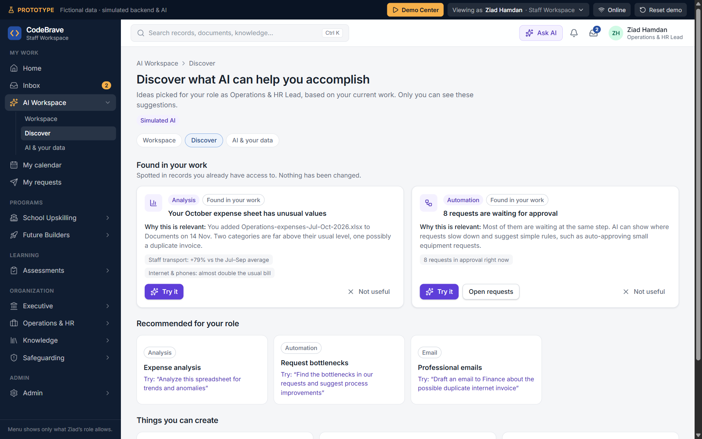
*Figure 16. "Discover what AI can help you accomplish" for Ziad. "Found in your work" shows two opportunities, each with a reason, supporting evidence, **Try it** and **Not useful**. Below: recommendations for the role and "Things you can create".*

**Where it appears:** **AI Workspace › Discover**, the welcome screen of the AI Workspace ("Found in your work"), and the top of each employee's **Home** page ("AI found something useful in your work"). Suggestions are not pushed as notifications.

**Examples in the prototype**

| Person | Suggestion | Why it is relevant |
|---|---|---|
| Ziad (Operations & HR) | Your October expense sheet has unusual values | Two categories are far above their usual level, one possibly a duplicate invoice |
| Ziad | Requests are waiting for approval | Most wait at the same step; simple rules could speed them up |
| Yasmin (Curriculum) | "My first animation" keeps getting difficulty reports | Teachers and trainers report the same problem, confirmed by observations |
| Yasmin | 62 teachers answered the Term 1 survey | Comments can be grouped into themes in minutes |
| Joelle (Fundraising) | Your impact evidence could strengthen the "Girls in Tech Futures 2027" proposal | The call asks for outcome data that Results & Indicators already holds |
| Omar (Project Officer) | Many visit reports mention the same challenge | Device readiness appears across several schools; it can be consolidated into an improvement brief |
| Omar | Tomorrow's visit to Riverside Intermediate | AI can prepare a one-page brief |
| Maya (School Upskilling manager) | Teaching Fellows below the coaching threshold | Observation scores below 2.5 trigger coaching |
| Tarek, Hala, Sami (Future Builders) | Students below 75% attendance; project milestones due | Early signs of disengagement; teams behind schedule |
| Rana (Co-founder) and Mira (M&E) | Observation quality and learning gain move together | A pattern worth investigating before the post-assessment |

**Try it** opens the AI Workspace with the task ready, attaching the sample file where relevant. Any resulting change still needs the person's confirmation.

### D. AI governance and responsible use

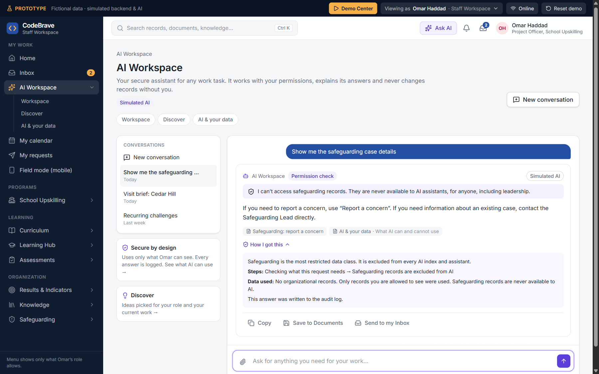
*Figure 17. Asked for safeguarding case details, the assistant declines: safeguarding records are never available to any AI assistant. "How I got this" explains the rule, and the refusal is written to the audit log.*

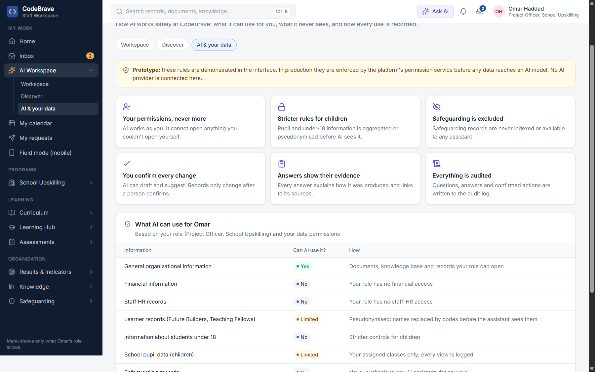
*Figure 18. "AI & your data" for Omar: six principles, then a table of what AI can use for him by type of information (Yes, Limited or No, with the reason). Further down the page: his recent AI activity from the audit log.*

| Principle | How the prototype demonstrates it |
|---|---|
| **Permission-aware access** | AI uses only what the person can see. Asking for salary information without HR access, or for individual pupil details without the pupil-data permission, is declined with an explanation. |
| **Organizational knowledge** | Answers cite their sources (records, documents, indicators) with links. |
| **Minors' data** | Pupil information is aggregated; Future Builders learners are pseudonymised (for example "Student 07") in AI answers. |
| **Safeguarding** | Excluded from every assistant, for every role, including leadership. |
| **Human approval** | AI drafts and suggests; any change to records requires a click on the suggested next step. Curriculum is never published or overwritten by AI. |
| **Explanation** | "How I got this" shows the reasoning, steps and data used for every answer. |
| **Auditability** | Answers, refusals and confirmed actions are added to the audit log (visible in AI & your data and in Admin › Audit log). |
| **Usage controls** | Agent runs and diagnostics are restricted to Admin › Agent Hub. Usage and cost limits are **Proposed**. |

> **Important.** These are demonstrations of intended behavior inside the user interface. **The prototype does not enforce security.** In production, permissions, pseudonymisation and exclusions must be enforced by the platform's back-end services before any information reaches an AI model, and the audit log must be stored securely. A yellow notice on the "AI & your data" page says so.

### E. How AI contributes to CodeBrave's mission

| Mission area | How AI helps (demonstrated or proposed) |
|---|---|
| Better educational programs | Visit briefs, observation analysis and coaching plans help Project Officers focus where pupils need it most. |
| Spotting learning difficulties early | Class learning profiles, at-risk student lists and missing-submission checks surface problems while there is still time to act. |
| Curriculum quality | Feedback and observations are analyzed together; lessons that passed review but struggle in classrooms are flagged for revision. |
| Impact measurement | Briefings and explanations link every figure to its source; relationships between indicators are surfaced for investigation. |
| Operational efficiency | Spreadsheet analysis, request bottlenecks and "work AI could do for you" free time for program work. |
| Fundraising and partnerships | Eligibility checks and proposal drafts reuse live evidence and consented stories. |
| Management decisions | A weekly briefing, explanations on demand and one-click investigation requests. |
| Discovering the unexpected | AI Discovery suggests things employees might never have thought to ask. |

---

## Part V: End-to-end workflows

Each workflow shows what happens, who does it, and where the information goes. Unless stated otherwise, the steps can be performed in the prototype with its fictional data; anything simulated or missing is said explicitly.

### 1. A new school joining School Upskilling

**Partly available.** Schools can be in **Onboarding** status with a **Draft** agreement (for example Almond Valley and Springfield), and they appear in the directory and on the overview cards.

**Not yet available:** a form to register a new school, upload or sign its agreement, or change its status. In production, onboarding would create the school record, its agreement, its classes and its assignments in one guided flow.

### 2. Assigning a Project Officer and trainer

**View only.** Each school shows its Project Officer and trainer, and **School Upskilling › Team & assignments** shows who covers which schools. Changing assignments is **Not yet available**.

### 3. Classes, teachers and pupils

**Available for viewing and attendance.** Open **Classes & rosters** or a school's **Classes** tab. Each class has a teacher (school-employed or Teaching Fellow), a timetable and a roster. Pupils have records but no accounts. Pupil names are visible only to people with the pupil-data permission; others see roster codes. Adding or moving pupils is **Not yet available**.

### 4. Visits, observations and follow-ups

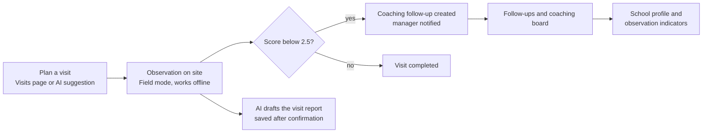

Plan a visit (School Upskilling › Visits & observations, or let AI plan visits for unvisited schools); complete the observation in Field mode or on the Visits page; synchronize if offline; a coaching task appears automatically for low scores; draft the visit report with AI; the manager sees the follow-up and a notification. Scenario: *A day in the field*.

### 5. Teaching Fellow recruitment, training, certification and deployment

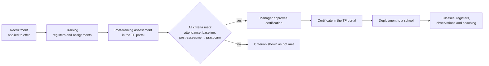

The trainer opens the post-assessment; the Teaching Fellow completes it in the portal; eligibility is checked automatically; the Project Manager receives an approval item, approves, and the certificate appears; deployment assigns the Teaching Fellow to a school and notifies them. Scenarios: *Becoming a Teaching Fellow* and *Training attendance and certification*.

### 6. Classroom attendance

There are three attendance workflows, each with its own rules:

- **Pupil class registers**, taken by class teachers and deployed Teaching Fellows;
- **Teaching Fellow training registers**, taken by trainers, with an 80% attendance threshold for certification;
- **Future Builders session registers**, taken by trainers, with an absence-streak rule.

For pupil registers, the teacher opens **Today**, then **Take register**, marks each pupil present, absent, late or excused, and submits. Registers never default to "present". Registers taken offline are saved as pending sync and uploaded on reconnection. Corrections are requested with a reason and approved by the Project Officer. Figures flow to the class, the school profile, the indicators and the cockpit. Scenario: *Taking the register*.

### 7. Annual pupil pre/post assessments and reconciliation

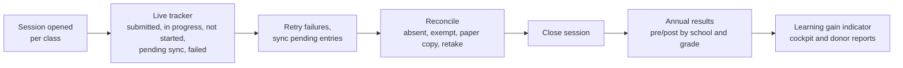

Only saved submissions count. Each missing pupil needs a recorded resolution before the session is closed. In the prototype, pupil devices are simulated with **Simulate live activity**.

### 8. Future Builders admissions and learner progression

Applicants move through admission stages. Admitted students under 18 need guardian consent before their account is active (simulated with a button). Active students follow their pathway course in the Student Portal, submit assignments that trainers grade, work on team and client projects, build portfolios, and can be matched to internships with consent. Scenario: *A student's journey*.

### 9. Curriculum creation, review, approval and publication

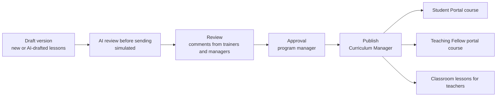

Running cohorts stay on their published version until a new version is published. Scenario: *From curriculum to classroom*.

### 10. Feedback and curriculum improvement

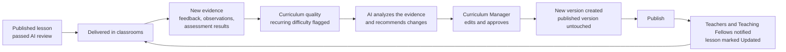

Steps (scenario *Closing the curriculum feedback loop*):

1. As Yasmin, open **Curriculum › Overview**; under "Lessons with recurring difficulties", open **My first animation**.
2. In the **Improvement loop**, click **Analyze new evidence**.
3. Read the recommendation; click **Edit** to change it if needed, then **Approve and create new version**.
4. Click **Publish … to classroom materials**.
5. As Salma (class teacher), see the lesson marked **Updated** under "Lessons for my classes".

### 11. Interactive learning activity creation and student completion

See [Part VI](#part-vi-interactive-learning-experiences).

### 12. Requests and approvals

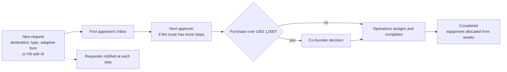

Scenario: *Getting things done*.

### 13. Meeting creation and calendar

Create an event from **My calendar › New event**, or with **Request a meeting** on a school profile. Choose participants and, for online meetings, create a **simulated** Meet link. Participants are notified in the platform; the event appears for everyone involved and, when it relates to a school, in that school's meeting history.

### 14. Executive insights and investigation requests

From the cockpit: read the briefing → open an off-track indicator or AI insight → **Explain** (an AI explanation with evidence) → **Ask [owner] to investigate** → the owner receives a high-priority Inbox task and a notification, and the request is recorded in the audit log.

### 15. AI Discovery leading to an approved action

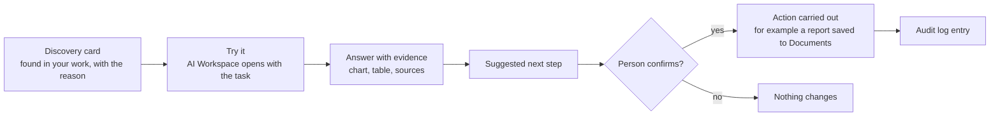

Example: Ziad's expense-sheet anomaly → analysis → **Create a management report from this** → the draft appears in Documents. Scenario: *AI that works for everyone*.

---

## Part VI: Interactive learning experiences

### The idea

Many lessons teach concepts that are hard to grasp from explanation alone: how the internet delivers a page, how a classifier learns, how a business model works. The proposal is that, when creating or editing a lesson, a Curriculum Manager can choose an optional **Interactive learning experience** format. AI turns the lesson's content into an activity, and a person reviews and publishes it. Proposed formats:

- **Drag-and-drop activities**: put the steps of a process in the right order, or match terms to their meanings.
- **Interactive simulations**: change inputs and watch what happens.
- **Concept challenges**: short scenario questions with instant explanations.
- **Virtual experiments**: test a hypothesis safely and compare results.
- **Scenario-based learning**: a branching story where choices have consequences.

### The working demonstration in the prototype

| Item | Detail |
|---|---|
| Lesson | "How the web works" |
| Program and pathway | Future Builders, Web Development pathway, unit "Foundations of the web" |
| Where | **Curriculum › Lessons › How the web works › Interactive experience** (`/curriculum/lessons/cur-web/les-how-the-web-works`) |
| Who creates it | The Curriculum Manager (Yasmin Awad) |
| Who uses it | Students on the Web Development pathway (for example Jana Saab), in **My learning** |

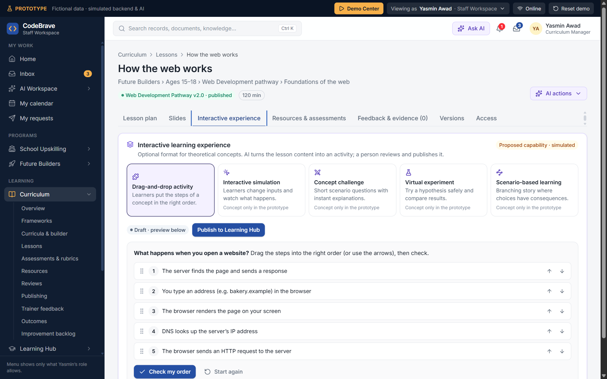
*Figure 19. The Interactive experience tab, marked **Proposed capability · simulated**. Five formats are offered; only "Drag-and-drop activity" works, and the others are labelled "Concept only in the prototype". After **Generate with AI**, a draft preview appears with **Publish to Learning Hub**.*

**Steps**

1. Viewing as Yasmin Awad, open the lesson above and select the **Interactive experience** tab.
2. Keep **Drag-and-drop activity** selected and click **Generate with AI**. After about a second and a half, a draft appears.
3. Try the preview: drag the five steps of a web request into order (or use the arrow buttons), then click **Check my order**.
4. Click **Publish to Learning Hub**. Jana receives a notification.
5. Switch to Jana Saab and open **My learning**. A "New interactive activity" card appears above the course modules.
6. Jana orders the steps and clicks **Check my order**. Correct steps turn green with a one-line explanation; otherwise she sees how many are in the right place and a hint ("names must become numbers first"). **Start again** reshuffles the steps.

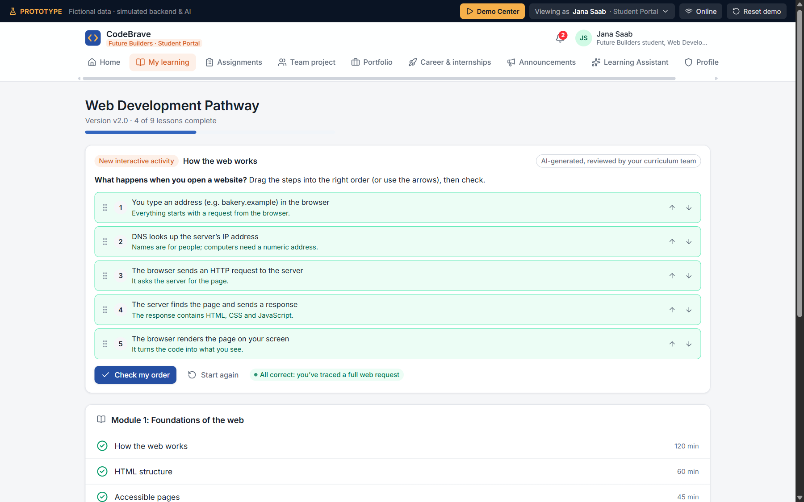
*Figure 20. Jana's view after completing the activity: every step correct, each with a short explanation, and the label "AI-generated, reviewed by your curriculum team".*

### What is and is not real

- The "generation" is **simulated**: the activity is **pre-built**, not created by AI.
- **Only the drag-and-drop format works.** Interactive simulations, concept challenges, virtual experiments and scenario-based learning are concepts shown for discussion; they are not working generators.
- **Only "How the web works" has an activity.** On other lessons, the tab shows the formats and points to this example.
- The activity is published as an **add-on** to the lesson; the approved lesson version itself does not change.
- Students' answers in the activity are not saved or reported.

### The larger opportunity (not yet built)

A full capability would let AI propose an activity from any lesson's objectives and content; let the Curriculum Manager edit steps, questions and feedback; check accessibility and age-appropriateness; support Arabic; version activities together with the curriculum; record learner attempts as formative evidence in the Assessment Hub; and feed difficulties back into the improvement loop. It would need a content model for activities, an authoring and review tool, safe AI generation, and learning analytics.

---

## Part VII: Feature status and capabilities register

### Status definitions

| Status | Meaning |
|---|---|
| **Available in prototype** | Working and demonstrable with the prototype's fictional data and interactions. |
| **Simulated** | The workflow or interface can be demonstrated, but the real service, integration, AI processing, storage or enforcement behind it is not connected. |
| **Proposed** | Part of the product vision, or partially demonstrated, but not a complete working capability. |
| **Not yet available** | Cannot be meaningfully demonstrated; requires future implementation. |

The "Production requirement" column summarizes what would be needed to make a capability real. It does not imply any approved plan, budget or timeline. Where a capability combines a working interface with a simulated engine, the row says so.

### Platform foundations

| Feature | Workspace | Status | What works today | What is missing | Production requirement |
|---|---|---|---|---|---|
| Back-end services | All | Not yet available | Everything runs in the browser | Server-side application and business rules | Back-end application and hosting |
| Persistent database | All | Not yet available | Fictional data in the browser tab | Lasting, shared storage | Managed database, backups |
| Authentication | All | Not yet available | "Viewing as" persona switcher | Accounts and sign-in | Identity provider (for example Google Workspace sign-in) |
| Role and permission model | All | Available in prototype | Menus, pages, data and actions differ by role; clear "no access" states | Enforcement outside the interface | Permission service checked on every request |
| Permission enforcement | All | Simulated | Rules applied in the interface only | Real protection of data | Server-side enforcement and data-level security |
| Data persistence across sessions | All | Not yet available | Changes last for the browser tab | Saving between sessions and users | Database |
| Audit log | Admin, AI & your data | Simulated | Entries for sensitive views, AI use and refusals | Complete, tamper-resistant storage | Append-only audit store, retention, monitoring |
| In-app notifications and Inbox | All | Available in prototype | Notifications and tasks created by workflows | Delivery outside the app | Notification service (email or push) |
| Email delivery | All | Not yet available | None | Sending email | Email service integration |
| Search | All | Available in prototype (limited) | Searches fictional records | Full-text search across documents | Search index with permission filtering |
| Offline work and synchronization | Field, Teacher, Assessments | Simulated | Offline toggle, pending-sync queue, upload on reconnection | Real device storage, conflict handling | Offline-capable app and sync service |
| Arabic / right-to-left | Teacher, Teaching Fellow portal | Available in prototype | EN · ع switch on teacher-related experiences | Translation of every screen | Translation workflow |
| Demo Center and guided scenarios | Prototype only | Available in prototype | 13 scenarios with automatic step checks | Not needed in production | Not applicable |

### AI

| Feature | Workspace | Status | What works today | What is missing | Production requirement |
|---|---|---|---|---|---|
| AI model or provider | All AI | Not yet available | None connected | A real model | AI provider agreement and secure integration |
| General-purpose AI tasks | AI Workspace | Simulated | Scripted answers for analysis, writing, translation, summaries, extraction, plans and brainstorming | Open-ended answers to any request | Model integration with prompt design and safety evaluation |
| File upload and processing | AI Workspace | Simulated | Six sample files fully "processed"; other uploads recognized by type only | Reading real files | Secure document processing for spreadsheets, PDFs, Word and slides |
| Editing, copying and saving results | AI Workspace | Available in prototype | Edit in place, copy, save to Documents, send to Inbox | Saving real files | Document storage integration |
| Conversation history | AI Workspace | Available in prototype (session only) | Seeded and new conversations; lost on reload | Persistence | Stored history with retention rules |
| Contextual AI | Most workspaces | Simulated | AI actions menus and side panel with context-aware scripted answers | Real reasoning over records | Model with retrieval of permitted records |
| AI Discovery | Home, AI Workspace | Simulated | Role- and data-based suggestions with reasons and evidence | Continuous discovery across all work | Background analysis, relevance tuning, user feedback |
| Organizational knowledge retrieval | All AI | Simulated | Answers cite fictional records and knowledge articles | Search over real documents | Retrieval index with permission filtering |
| Permission-aware AI | All AI | Simulated | Refusals for safeguarding, individual pupil and HR data; pseudonymised learners | Enforcement before data reaches a model | Policy enforcement, redaction and pseudonymisation services |
| AI-proposed actions with confirmation | All AI | Available in prototype | Actions run only after confirmation (create a request, save a report, plan visits, create follow-ups or check-in tasks) | The same actions against real systems | Back-end actions with authorization |
| Explanations and sources | All AI | Available in prototype | "How I got this" and source links on every answer | Explanations from a real model | Traceable model outputs |
| Usage and cost controls | Admin | Proposed | Agent Hub shows agents with illustrative run counts, costs and a monthly budget | Real metering, quotas and enforcement | Usage metering and administration |
| Audit of AI operations | AI & your data, Admin | Simulated | Each answer, refusal and confirmed action is listed | Secure, complete AI audit | Audit store connected to the AI service |

### Integrations

| Feature | Status | What works today | What is missing | Production requirement |
|---|---|---|---|---|
| Google Workspace (sign-in, Drive, Docs) | Not yet available | Documents are listed as records only | Everything | Google Workspace integration |
| Google Calendar | Simulated | Shared calendar inside the platform, labelled "Google Calendar sync: simulated" | Real synchronization and invitations | Calendar API integration |
| Google Meet | Simulated | Meet-style link generated and labelled as not real | Real meetings | Meet integration |
| Google Slides | Simulated | Slide previews on lessons; "create the slides" saves a document record | Real slide decks | Slides integration |
| Email | Not yet available | None | Sending and receiving | Email service |
| Spreadsheet import (for example school rosters) | Proposed | Admin › Integrations shows an illustrative column-mapping preview | Real import | Import tool with validation |

### Educational capabilities

| Feature | Workspace | Status | What works today | What is missing | Production requirement |
|---|---|---|---|---|---|
| Curriculum versioning and publishing | Curriculum | Available in prototype | Draft, review comments, approval, publish to portals and classroom materials | Rich content editing | Authoring tools and content storage |
| Lesson library and lesson pages | Curriculum | Available in prototype | Program → grade → subject → unit → lesson; full lesson page | Hand-written plans for most lessons | Real curriculum content |
| Lesson-level access management | Curriculum | Simulated | Settings with confirmation | Enforcement | Permission service |
| AI lesson drafting and AI review | Curriculum | Simulated | Scripted draft and review results | Real generation and review | Model integration |
| Teacher and trainer feedback loop | Curriculum, Teacher | Available in prototype (AI analysis simulated) | Evidence, recommendation, edit, approve as a new version, publish, teachers notified | Real analysis; feedback collection from every classroom | Model integration; feedback capture in classrooms |
| Learning Hub | Learning Hub, portals | Available in prototype | Courses per environment, progress, grading, certificates | Hosted content, video, coding exercises | Learning content hosting |
| Assessment Hub and live tracking | Assessments | Available in prototype | Live statuses, retry, reconciliation, close | A real pupil test-taking application | Assessment delivery app |
| Offline assessment synchronization | Assessments | Simulated | Pending sync and upload on reconnection | Real offline devices | Offline-capable delivery and sync |
| Interactive lesson generation | Curriculum, Student Portal | Simulated (one example) | One pre-built drag-and-drop activity, publishing, student completion with feedback | Generation for any lesson; saved results | Generation service, authoring and review tools |
| Interactive formats other than drag-and-drop | Curriculum | Proposed | Shown as concepts | Everything | Activity engines for each format |
| Student progress and learning analytics | Learning Hub, Results | Available in prototype (basic) | Progress by course and pathway, at-risk lists | Detailed learning analytics | Learning event tracking and analytics |
| Class learning profile | School Upskilling | Simulated | Class-level suggestions from aggregated results | Real AI analysis | Model integration with strict aggregation |

### Organizational capabilities

| Feature | Workspace | Status | What works today | What is missing | Production requirement |
|---|---|---|---|---|---|
| School management | School Upskilling | Available in prototype (view and operate) | My schools, school profiles, meetings, AI actions | Creating and editing schools, assignments, classes and pupils | Forms and back-end records |
| Visits, observations and coaching | School Upskilling, Field mode | Available in prototype | Plan, observe, automatic coaching follow-ups, AI visit reports | A real mobile app | Mobile or offline-capable web app |
| Future Builders management | Future Builders | Available in prototype | Admissions, sessions, projects, mentorship, internships | Real consent collection and messaging | Consent and communication services |
| Teaching Fellow lifecycle | School Upskilling, TF portal | Available in prototype | Training through certification and deployment | Certificate documents, contracts | Document generation, HR integration |
| HR and operations | Operations & HR | Available in prototype (partly illustrative) | Requests, assets, onboarding and recruitment views | Payroll, contracts, real leave balances | HR system integration |
| Requests and approvals | My requests, Operations, Inbox | Available in prototype | Destination-first form, AI fill, routes, history | Configurable routes, email notices | Workflow configuration, email |
| Calendar and meetings | Calendar | Available in prototype (integrations simulated) | Month, week and day; create and edit; meeting requests | Real invitations | Calendar integration |
| Fundraising and partnerships | Fundraising, Partner Access | Available in prototype | Pipeline, eligibility (scripted), report approval and donor view | Real funding research and submissions | Integrations, document generation |
| Executive reporting | Executive | Available in prototype | Cockpit, decisions, investigation requests, meeting agendas | Board-pack generation | Document generation |
| Results and indicators | Results & Indicators | Available in prototype (ten live, the rest illustrative) | Dashboard, definitions, drill-downs | Historical data, more live indicators | Data history and data-quality processes |
| Safeguarding | Safeguarding | Available in prototype (restricted views) | Report a concern; case list visible only to the Safeguarding Lead | Secure case management | Dedicated secure case system |
| Partner portals | Partner Access | Available in prototype | Client, host and donor views with restricted data | Real external accounts | External identity and invitations |

---

## Part VIII: Limitations and future development

The prototype shows **how CodeBrave would work**; it is not a system ready for real use. The main gaps, in plain terms:

**Infrastructure and back end.** Everything runs inside the web browser on one computer. A real platform needs servers, a database, hosting, backups, separate environments for testing and release, and ongoing maintenance.

**Authentication and permissions.** There are no real accounts; the persona switcher demonstrates what each role would see. Production needs secure sign-in (ideally with CodeBrave's existing accounts), permissions enforced on the server for every action and every piece of data, and regular access reviews.

**AI providers and execution.** No AI model is connected; answers are scripted. Production needs a chosen AI provider, a secure integration that sends only permitted information, quality and safety evaluation, usage limits, cost monitoring, and guidance for staff.

**Document processing.** Only six sample files are "understood". Real processing of spreadsheets, PDFs, Word documents and slides needs secure file handling, extraction and storage rules.

**Integrations.** Google Workspace (sign-in, Drive, Docs, Slides), Google Calendar and Meet, and email are simulated or absent. Each needs a configured integration and agreed data-sharing rules.

**Data persistence.** Changes last only for the current browser tab. Production needs a database, the import of today's spreadsheets, and data-quality processes.

**Security, privacy and safeguarding.** The prototype demonstrates the intended rules (stricter handling of children's data, isolated safeguarding records, pseudonymisation for AI) but does not enforce them. Production requires technical enforcement, encryption, a privacy and child-protection review, consent records, retention and deletion processes, and a dedicated secure safeguarding case system.

**Offline functionality.** Offline mode is a switch. Real offline use needs an application that stores data safely on phones and tablets, synchronizes reliably and resolves conflicts.

**Monitoring and auditing.** The audit log is a list in the browser. Production needs a complete, tamper-resistant audit store, monitoring and alerting.

**Educational capabilities.** Curriculum content is mostly structural, slides are previews, and there is no hosted learning content or pupil test-taking application. These require content creation and appropriate delivery tools.

**Interactive learning.** One pre-built activity demonstrates the idea. A real capability needs an activity model, generation with human review, authoring tools, accessibility and Arabic support, and learner analytics.

**Operational readiness.** Staff training, support processes, data migration, a pilot with a small group of schools and staff, and governance for AI use would all be needed before wider rollout.

Turning the proposed capabilities into real services would normally start with the foundations (accounts, database, permissions), then the highest-value daily workflows (registers, assessments, visits, requests), then integrations and AI. **No timeline, budget or production decision is implied by this guide.**

---

## Part IX: Stakeholder demonstration guide

A suggested 30–40 minute guided exploration that tells one connected story. Before starting, click **Reset demo** in the prototype bar so everyone sees the same data.

| Step | Viewing as | Open | Do | What the audience should understand | Disclose |
|---|---|---|---|---|---|
| 1 | Rana Khoury (Co-founder) | Home or **Executive › Overview** | Read the program health cards and **Your briefing**; scroll to **Needs your attention** | Leadership sees only what needs a decision, with the reason and the evidence | Briefing is simulated AI over fictional data; some indicators are illustrative (marked *) |
| 2 | Rana | Executive › Overview | Click **Explain** on an off-track indicator, then **Ask … to investigate** | AI explains; one click turns insight into action for the responsible manager | AI explanation is scripted |
| 3 | Ziad Hamdan (Operations & HR) | **AI Workspace › Discover** | Open "Your October expense sheet has unusual values" and click **Try it** | AI proactively finds opportunities in a person's own work | Discovery is simulated; the file is fictional |
| 4 | Ziad | AI Workspace | Read the chart and anomalies; confirm **Create a management report from this**; try a follow-up such as the email to Finance and edit it | Any work task, no prompting skills needed; nothing changes without confirmation | No real file processing; no email is sent |
| 5 | Omar Haddad (Project Officer) | AI Workspace | Type "Show me the safeguarding case details"; open **How I got this**; then open **AI & your data** | AI respects permissions; safeguarding is excluded; everything is audited | Rules are demonstrated, not enforced |
| 6 | Maya Saleh (School Upskilling manager) | **School Upskilling** | Review the school cards; open **Cedar Hill**; use **AI actions › Prepare a visit brief**; **Request a meeting** with the principal | Work is organized around schools; AI and the calendar are part of the school record | Meet link and calendar sync are simulated |
| 7 | Yasmin Awad (Curriculum Manager) | **Curriculum › Overview**, then **My first animation** | **Analyze new evidence**, **Edit**, **Approve and create new version**, **Publish** | Classroom evidence improves curriculum even after a lesson passed review; people decide | AI analysis is scripted |
| 8 | Salma Haidar (Class teacher) | **Today** | Find **My first animation** marked **Updated** under "Lessons for my classes" | The improvement reaches the classroom | Nothing additional |
| 9 | Yasmin | **How the web works › Interactive experience** | **Generate with AI**, try the preview, **Publish to Learning Hub** | A vision for interactive learning of theoretical concepts | Proposed capability; pre-built activity; only drag-and-drop works |
| 10 | Jana Saab (Student) | **My learning** | Complete the activity and click **Check my order** | Learners get engaging practice with instant feedback | Answers are not recorded |
| 11 | Maya Saleh | **Learning Hub**, then **Assessments › Live tracker** | Explain Curriculum → Learning Hub; open a live session; show statuses, retry and reconciliation | Learning is delivered and measured in one connected system; only saved submissions count | Pupil devices are simulated |
| 12 | Mira Chahine (M&E Officer) | **Results & Indicators › Dashboard** | Filter by program and grade; open an indicator for its definition and evidence | Figures are calculated from everyday records and traceable to evidence | Ten indicators are live, the others illustrative |

**Shorter version (about 15 minutes):** steps 1, 3, 4, 5, 7, 9 and 10. Alternatively, open the **Demo Center** and run *AI that works for everyone* and *Closing the curriculum feedback loop*, which guide the presenter step by step.

**If something goes wrong.** Click **Reset demo**, or start the relevant Demo Center scenario, which resets the data and takes you to the right page. If the page shows an error after the prototype was restarted, reload the page; if it persists, restart the prototype as described in [Opening the prototype](#opening-the-prototype).

---

## Appendix A: Demonstration personas

All names are fictional.

| Person | Role | Experience | Good for demonstrating |
|---|---|---|---|
| Rana Khoury | Co-founder & Executive Director | Staff | Cockpit, decisions, investigation requests |
| Maya Saleh | Project Manager, School Upskilling | Staff | Partner schools, certification approvals |
| Omar Haddad | Project Officer, School Upskilling | Staff and Field mode | Visits, offline observations, AI briefs |
| Jad Mansour | Trainer, School Upskilling | Staff and Field mode | Training registers, Teaching Fellow assessments |
| Tarek Daher | Project Manager, Future Builders | Staff | Admissions, cohort health, placements |
| Hala Rizk | Project Officer, Future Builders | Staff | Absence follow-ups, internships |
| Sami Khalil | Trainer & Mentor, AI pathway | Staff | Grading, at-risk students |
| Yasmin Awad | Curriculum Manager | Staff | Curriculum loop, interactive lessons |
| Ziad Hamdan | Operations & HR Lead | Staff | Requests, assets, AI analysis |
| Joelle Matar | Fundraising & Partnerships Lead | Staff | Eligibility, proposals, donor reports |
| Mira Chahine | M&E Officer | Staff | Indicators and evidence |
| Elie Gerges | Platform Administrator | Staff (Admin) | Permissions, Agent Hub, audit log |
| Nadine Fares | Safeguarding Lead | Staff | Restricted case list |
| Salma Haidar | Class teacher, Cedar Hill Public School | Class Teacher (English/Arabic) | Registers, lessons for my classes |
| Layla Hassan | Teaching Fellow (deployed), Cedar Hill | Teaching Fellow portal (English/Arabic) | Classes, observation feedback |
| Rami Youssef | Teaching Fellow (in training) | Teaching Fellow portal (English/Arabic) | Assessments, certificate |
| Jana Saab | Future Builders student, Web Development | Student Portal | Learning, interactive activity |
| Nabil Saade | Client, Mount Pine Bakery Co. | Partner Access | Milestone sign-off |
| Rita Kassab | Internship host, Brightline Digital | Partner Access | Consented candidates |
| Helen Moore | Program officer, Northbridge Foundation | Partner Access | Approved donor reports |

## Appendix B: Useful addresses in the prototype

Switch to the appropriate persona first (see [Viewing as: switching personas](#viewing-as-switching-personas)). All addresses start with `http://localhost:5180`.

| Page | Address |
|---|---|
| Home | `/` |
| Demo Center | `/demo` |
| AI Workspace, Discover, AI & your data | `/ai`, `/ai/discover`, `/ai/trust` |
| Executive cockpit | `/executive` |
| School Upskilling overview, Cedar Hill profile | `/school-upskilling`, `/school-upskilling/schools/sch-01` |
| Future Builders overview | `/future-builders` |
| Curriculum overview, Lessons | `/curriculum`, `/curriculum/lesson-plans` |
| Feedback-loop lesson | `/curriculum/lessons/cur-cls/les-my-first-animation` |
| Interactive lesson | `/curriculum/lessons/cur-web/les-how-the-web-works` |
| Learning Hub | `/learning` |
| Live submission tracker | `/assessments/tracker` |
| Results dashboard, Indicator library | `/results`, `/results/library` |
| Calendar, My requests, all requests | `/calendar`, `/requests`, `/operations/requests` |
| Field mode | `/field` |
| Portals | `/student`, `/tf`, `/teacher`, `/partner` |

## Appendix C: Glossary

| Term | Meaning |
|---|---|
| **Aggregated** | Shown only as totals or averages (for example by class or school), never per person. |
| **Audit log** | A record of who did what, including AI answers and confirmed actions. |
| **Class teacher** | A school-employed teacher in a partner school. |
| **Contextual AI** | AI actions offered on the page you are working on. |
| **Indicator** | An official figure with a target, an owner and a definition (for example the pupil attendance rate). |
| **Live / illustrative** | Live figures are calculated from platform records; illustrative figures are samples for the prototype. |
| **Observation** | A structured classroom observation scored on a 1–4 rubric. |
| **Pending sync** | Saved offline and waiting to upload. |
| **Persona** | A fictional person used to demonstrate a role. |
| **Pre/post assessment** | The annual pupil assessments at the start and end of the year, used to measure learning gain. |
| **Pseudonymised** | Names replaced by codes so a person cannot be directly identified. |
| **Reconciliation** | Checking every expected submission before closing an assessment session, and recording why any is missing. |
| **Safeguarding** | Protecting children and young people from harm; safeguarding records are the most restricted information. |
| **Simulated** | Demonstrated in the interface without the real service behind it. |
| **Teaching Fellow** | A trained educator whom CodeBrave recruits, certifies and deploys to partner schools. |
| **Version (curriculum)** | A fixed snapshot of a curriculum. Published versions never change; improvements create new versions. |
